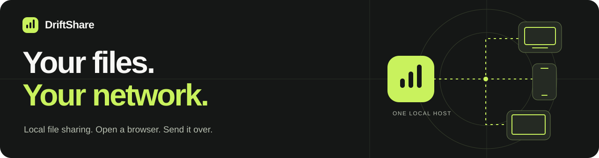
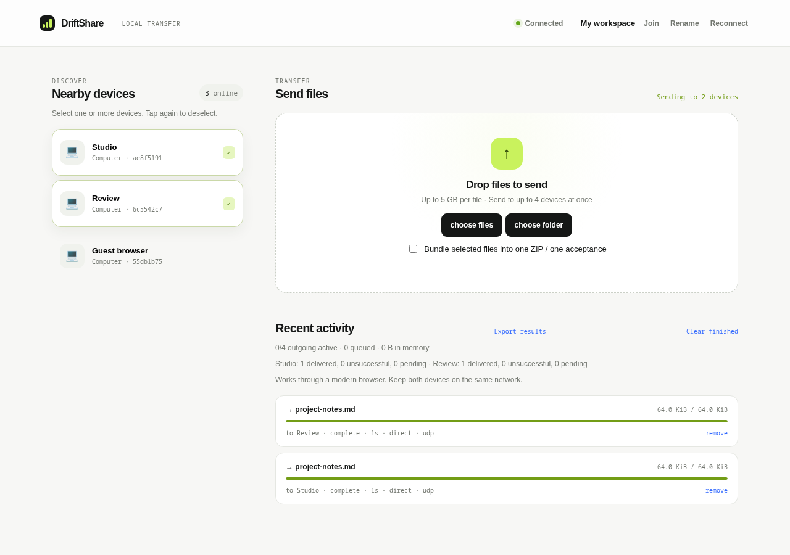

<p align="center">
  
</p>

<p align="center">
  <strong>5 GB files &nbsp; · &nbsp; Multiple recipients &nbsp; · &nbsp; No cloud account</strong>
</p>

<p align="center">
  <a href="#get-started">Get started</a> &nbsp; / &nbsp;
  <a href="docs/README.md">Documentation</a> &nbsp; / &nbsp;
  <a href="CONTRIBUTING.md">Contribute</a> &nbsp; / &nbsp;
  <a href="LICENSE">MIT license</a>
</p>

DriftShare moves files between devices on your local network using their browsers.
Run it on one computer, open its link on your other devices, and choose who gets a copy.
Once installed, it works without internet access.

Send a file to your other computer, share a folder with your team, or deliver the same
batch to several devices. Each recipient gets their own acceptance prompt and progress.



<sub>Actual interface after a transfer between local browser sessions. Device labels are illustrative.</sub>

## Built for sharing nearby

- **Bring your browser.** Receiving devices need no app or account. One computer runs the host.
- **Send up to 5 GB per file.** Large files stream to a native writer or browser Downloads.
- **Share with a group.** Up to four outgoing recipient deliveries at once, with separate acceptance, cancellation, and retry.
- **Send folders together.** Bundle folders or selected files into one ZIP and one acceptance per recipient.
- **Recover interrupted downloads.** Eligible LAN-host downloads can resume within 15 minutes while the original tabs and host remain open.
- **Keep the infrastructure local.** The UI, joining, signaling, and optional relay run on your host.

## Get started

Install **Node.js 22+** and Git on the host computer, then run:

```sh
git clone https://github.com/Edson-Edwin/Driftshare.git
cd Driftshare
npm ci
npm start
```

**Join → Choose → Accept.** Open a private link printed in the terminal on each device.
Select the receiving devices, choose your files, and accept on each receiver.

All devices must be able to reach the host on the local network. Use the host's printed
LAN address on a phone, not `localhost`. Keep the host and browser tabs running.
Dependencies must be installed before you go offline.

**Want encrypted page access and relayed transfers?** With OpenSSL installed on the host:

```sh
npm run start:secure
```

The offline HTTPS launcher uses port `4443` and creates a local certificate authority.
Each device must trust its public certificate once. The regular `npm start` uses HTTP
on port `4000`; use that only on a trusted LAN.
[Follow the setup guide →](docs/getting-started.md)

## How files travel

**Direct:** Browser → browser over encrypted WebRTC, with receiver flow control and
integrity checks. Supported browsers can save directly to disk.

**Via LAN host:** Browser → your host → browser Downloads. This makes large downloads
available when direct saving is unavailable. The host streams the bytes without storing
a payload file, but it can read them; use HTTPS to encrypt these network connections.

The recipient sees the chosen route before accepting.
[Explore the architecture →](docs/architecture.md)

## Across your devices

DriftShare targets modern browsers on **Windows, macOS, Linux, Android, iOS, and iPadOS**.
Only the host needs Node.js. Features such as direct disk saving and download resume
vary by browser; native Downloads is the large-file fallback.

Automated checks cover Chromium, Firefox, and Playwright WebKit. Physical-device
qualification is still in progress, especially mobile 5 GB downloads and resume.
[View compatibility and testing →](docs/testing.md)

<details>
<summary><strong>Before a large transfer</strong></summary>

- The limit is **5,000,000,000 bytes per file**, about 4.66 GiB. The 128 MiB in-memory
  budget applies to retained small files, not the maximum transfer size.
- Folders support up to 1,000 files within the 5 GB archive limit. ZIP preparation reads
  the files first; empty directories are omitted.
- Keep phones awake and the page visible. Background transfers are not guaranteed.
- **Sent to browser Downloads** is not confirmation of a disk save. Check Downloads.
  For small files retained in the tab, click **save file** before clearing the card.
- WebRTC retry starts from zero. Relay resume requires the original tabs and host;
  it cannot recover after a source reload, host restart, expiry, or completed session.
- Group delivery sends separate copies that share bandwidth. Actual speed depends on
  your network and storage; there is no guaranteed throughput.
- Trust the host and keep join links private. This is a LAN tool, not a public file server.

[Full user guide](docs/usage.md) · [Security and privacy](docs/security.md)

</details>

## Find your next step

| Using DriftShare | Building DriftShare |
| --- | --- |
| [Setup and first transfer](docs/getting-started.md) | [Architecture and protocol](docs/architecture.md) |
| [Files, folders, groups, and resume](docs/usage.md) | [Development and contributions](CONTRIBUTING.md) |
| [Configuration and offline HTTPS](docs/configuration.md) | [Tests and platform qualification](docs/testing.md) |
| [Troubleshooting and FAQ](docs/troubleshooting.md) | [Benchmarks and measurement](docs/benchmarking.md) |
| [Security and privacy](docs/security.md) | [Changelog](CHANGELOG.md) · [Roadmap](docs/roadmap.md) |

## Make it better

Help test a device, improve accessibility, fix a bug, or clarify a guide. The code uses
**Node.js, Express, WebRTC, and plain JavaScript**—there is no frontend build step or database.

```sh
npm ci
npm run check
npm test
```

Read [Contributing](CONTRIBUTING.md) before your first pull request.
[Report a bug](https://github.com/Edson-Edwin/Driftshare/issues/new?template=bug_report.yml),
[suggest a feature](https://github.com/Edson-Edwin/Driftshare/issues/new?template=feature_request.yml),
or follow the [security policy](SECURITY.md) for vulnerability reports.

---

[MIT licensed](LICENSE). Built for local sharing. Third-party dependencies retain their own licenses.
