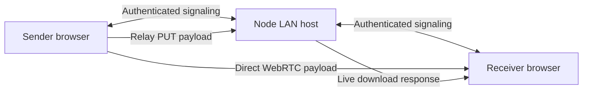

# Architecture and protocol notes

[Documentation home](README.md) · [Contributing](../CONTRIBUTING.md)

This is an implementation reference for contributors, not a versioned public API.
Keep client and host revisions aligned. The source files linked below remain the
source of truth when protocol details change.

## Components

| File | Responsibility |
| --- | --- |
| [`server.js`](../server.js) | HTTP(S), static assets, joining, peer discovery, signaling authorization, and lifecycle limits |
| [`relay.js`](../relay.js) | Live HTTP streaming, capability authentication, range recovery, and relay cleanup |
| [`public/protocol.js`](../public/protocol.js) | Shared IDs/metadata validation, byte limits, CRC32, terminal states, and platform labels |
| [`public/client.js`](../public/client.js) | Browser state, recipients, queue, consent, RTC sessions, flow control, saving, and UI |
| [`public/archive.js`](../public/archive.js) | Portable paths and ZIP/ZIP64 generation using source File/Blob parts |
| [`public/index.html`](../public/index.html), [`public/style.css`](../public/style.css) | Interface, dialogs, responsive styling, and accessibility markup |
| [`scripts/offline-https.cjs`](../scripts/offline-https.cjs) | Local CA creation, leaf renewal, and secure host launch |
| [`scripts/benchmark.cjs`](../scripts/benchmark.cjs) | Random fixtures and comparison of supplied measurements |
| [`test/`](../test) | Node regression and real-browser integration checks |

There is one Node process and no database, message broker, bundler, or application
payload store. `createDriftServer()` is exported for tests and embedding; it returns
the HTTP server, WebSocket server, peer/transfer maps, access code, and join URL helper.
Normal command-line startup is handled when `server.js` is the entry point.

## Data paths

The diagram shows alternative payload paths, not duplicate transmission for a single
recipient. In direct mode the host does not relay file bytes. In relay mode each
recipient has a separate upload/download stream pair; group delivery is not multicast.
The host remains necessary for discovery and signaling in either mode.

## Joining and discovery

1. The browser loads local assets and reads an optional `#code` fragment.
2. It opens a same-origin WebSocket on `/` and sends `hello` with the shared code,
   device label, device type, RTC availability, and optional reconnect credential.
3. The host verifies authentication and returns `welcome` with a peer ID,
   reconnect token, and join URLs.
4. Authenticated clients receive `peers` lists excluding their own current socket.

Reconnect credentials can restore a disconnected peer ID for a bounded period, but
cannot claim a currently connected ID. They live in page memory, not durable browser
storage. Successful reconnect is therefore distinct from page reload recovery.

## Offer and direct-transfer lifecycle

The local queue emits `file-offer` only when a recipient slot is available. The host
validates transfer IDs and metadata, prevents duplicates, records sender/receiver
ownership, and forwards the offer. The receiver accepts or rejects before RTC
signaling is permitted.

| Signaling message | Role |
| --- | --- |
| `hello`, `auth-required`, `welcome`, `peers`, `rename` | Joining, authentication feedback, identity, and discovery |
| `file-offer`, `file-accept`, `file-reject` | Recipient consent and route selection |
| `rtc-signal` | Authorized SDP/ICE exchange for an accepted direct transfer |
| `file-keepalive` | Keeps an accepted direct transfer's host state active |
| `file-received` | Receiver reports finalized direct reception to host state |
| `file-cancel`, `file-error` | Terminate a participant-owned transfer |
| `relay-ready`, `relay-progress`, `relay-paused`, `relay-complete` | Host-download capabilities and progress/recovery state |

RTC connections use `iceServers: []`. Connections are reused for consecutive files,
with separate sessions for each sending direction to avoid negotiation conflicts.
Idle sessions close after one minute. Each transfer has its own data channel.

The receiver sends a `ready` control message with a credit window. The sender reads
1 MiB source blocks and sends binary chunks no larger than 64 KiB, reduced when the
negotiated SCTP limit requires it. Receiver `ack` messages return cumulative credits
after consuming/writing bytes. At most 2 MiB of payload may be outstanding under the
application credit protocol; browser and network buffers add their own overhead.

After the final acknowledgment, the sender emits `end` with byte length and CRC32.
The receiver waits for queued writes, checks exact size and checksum, and closes the
native writer or creates a retained Blob. It then emits `complete` to the sender and
`file-received` to the host. A retained Blob is verified reception, not yet a disk save.
Errors and cancellation must release reservations and invalidate active work without
allowing a late callback to change a finished transfer.

## Relay and range recovery

1. Recipient consent selects relay, optionally with resumable recovery enabled.
2. The host sends the receiver a capability URL in `relay-ready`.
3. `GET /relay/:id?token=…` attaches the download response and rotates the upload token.
4. The host sends the sender a relay `file-accept`, including the requested offset
   and attempt-specific upload token.
5. The sender issues `PUT /relay/:id` with `Authorization: Bearer …`, a raw File or
   `File.slice(offset)` body, and the exact remaining content length.
6. A bounded Node Transform counts bytes and pipelines the upload into the response
   with backpressure. Completion removes the transfer and invalidates capabilities.

Download tokens are per transfer; upload tokens rotate per attempt. The host rejects
concurrent duplicate streams and incorrect lengths/content encoding. This is a live
source-to-receiver bridge, not a server object store: the sender must still have the
File when the receiver requests bytes.

| HTTP result | Meaning |
| --- | --- |
| `200` | Full download stream |
| `206` | Accepted resumable single range through end of file |
| `400` | Upload length or encoding does not match the accepted offer |
| `403` | Missing, expired, or invalid transfer capability |
| `405` | HEAD cannot consume a download stream |
| `409` | Download/upload already active or upload attempted before download is ready |
| `416` | Unsupported/invalid range or mismatched `If-Range` |
| `503` | Resumable source temporarily offline; retry after reconnect |

A resumable GET supports `Range: bytes=offset-`, or an explicit end equal to `size-1`.
Suffix ranges, multipart ranges, and arbitrary bounded subranges are not implemented.
The ETag is based on the transfer ID; it is not a content hash. Resume responses
include `Content-Range`, `Accept-Ranges`, and the remaining `Content-Length`.

An interrupted resumable stream becomes paused. Existing stream references are detached
and the attempt counter is advanced before destruction so stale callbacks cannot
complete or fail a replacement attempt. Client upload attempts likewise distinguish
their own abort controller from newer attempts. Preserve these guards when refactoring.

## State and limits

The client distinguishes queued, offering, connecting, sending, receiving, verifying,
paused, and terminal states (`done`, `error`, `cancelled`, `rejected`). The host keeps
offered/accepted state and relay attempt/pause details. These are related but not
identical state machines; do not derive a successful native disk save from host state.

| Bound | Current value / location |
| --- | --- |
| Maximum file bytes | 5,000,000,000 in `protocol.js` |
| Retained small-file payload budget | 128 MiB in `protocol.js` |
| Direct receive-credit window | 2 MiB in `protocol.js` |
| Direct chunk maximum | 64 KiB in `protocol.js`, reduced by negotiated limit |
| Source read block | 1 MiB in `client.js` |
| Concurrent outgoing recipient slots | 4 in `client.js` |
| Pending delivery queue | 1,000 entries in `client.js` |
| Files per generated archive | 1,000 in `archive.js` |
| Host WebSocket connections | 64 in `server.js` |
| Outstanding sender participation / recipient incoming offers | 8, checked when accepting a new offer |
| WebSocket frame payload | 64 KiB; per-message deflate disabled |
| WebSocket message rate | 120 messages per second per connection |
| WebSocket upgrade attempts | 60 per minute per connection IP |
| Wrong join codes | 5 per minute per connection IP across reconnects and QR requests |
| Initial authentication deadline | 60 seconds |
| Offer timeout | 120 seconds |
| Client active-transfer inactivity check | 45 seconds; resumable relay can pause |
| Host active-transfer / HTTP inactivity bounds | 90 seconds, subject to lifecycle handling |
| Paused relay/reconnect retention | 15 minutes, with periodic host cleanup |
| Host maintenance interval | 30 seconds |

Timers are inactivity controls, not total file duration limits. Node's overall upload
request deadline is disabled, allowing steadily progressing multi-gigabyte streams.
Changing limits requires corresponding tests, documentation, and consideration of
multiple senders, slow storage, and disconnected participants.

## Archive design

`archive.js` validates portable paths and checks a conservative size estimate before
reading content. It calculates each file's CRC incrementally, reusing a 64 KiB BYOB
buffer when available, then assembles header bytes and source File objects as Blob
parts. ZIP64 metadata is emitted when offsets or file sizes require it. No compression
is performed; timestamps are deterministic and empty directories are omitted.

Bounded checksum reads do not imply a universal bound on the browser's Blob storage
or total process RSS. The large archive test measures sampled JavaScript heap, which
must be reported with that qualification.

## Invariants for changes

- No payload or RTC negotiation before the intended recipient consents.
- A transfer ID never overwrites another participant's active state.
- Advertised length, credits, and byte offsets are validated before use.
- Completion follows verification/finalization for the direct path; relay wording
  remains limited to what the host actually observes.
- Cancellation, disconnect, and stale async callbacks cannot affect a later attempt.
- Large payloads are streamed; do not introduce full-file ArrayBuffers or base64 copies.
- Capabilities and reconnect credentials do not leak into exports or public logs.
- Queued selection changes and targeted retry do not silently add recipients.

See [Testing](testing.md) for the checks that protect these invariants.
